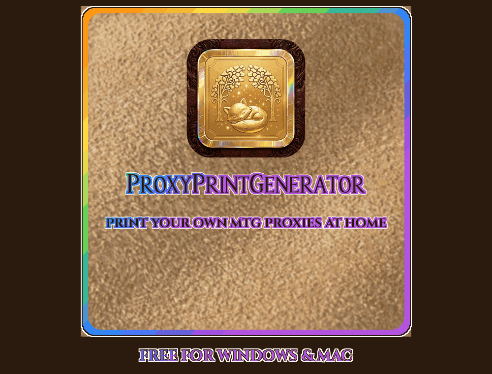

<p align="right">
  <a href="https://ko-fi.com/kommermail"></a>
</p>


# ProxyPrintGenerator

Print playtest proxies of your decks on a home printer. Paste a deck list or open a `.txt` file, choose the printing for each card, and get print-ready sheets on Letter, A4, Legal, 11×17, A3 or any paper size your printer lists. Letter and A4 hold nine cards at true size, 11×17 and A3 hold sixteen, each with a border-color bleed and dotted cutting guides. You can save the result as a PDF, PNG or JPEG, or print it straight from the app.

**A little vibrance magic makes them look like the real thing.** Home printers tend to print cards dull and dark. Flip the **Auto** switch on the realism sticker and the app boosts the colors and lifts the midtones, so your proxies come out bright and punchy, much closer to a real card in the sleeve.


## Download

Get the latest `ProxyPrintGenerator-…-win-x64.zip` from **[Releases](../../releases)**, unzip it, and run `ProxyPrintGenerator.exe`. It runs on Windows 10 or 11, 64-bit, and needs nothing installed. The first time you run it, Windows SmartScreen may warn you because the app isn't code-signed. Click **More info → Run anyway**.

After that, the app can keep itself up to date. The first time it opens, it asks whether it may check GitHub for a newer version each time it starts. When there is one, it shows what's new and asks before installing. **Update now** downloads the release zip, checks it against the checksum GitHub lists, and restarts into the new version.

**Is it safe?** Yes. That warning appears for almost any new app without a paid code-signing certificate, and it's normal for this one. Every release is tested before it goes out: on the developer's own PC, and on a fresh Windows machine in the cloud, where it's also scanned with Microsoft Defender ([see the checks](../../actions/workflows/release-check.yml)). The app connects only to Scryfall, plus GitHub if you allow update checks ([details](#what-the-app-connects-to)). It installs nothing beyond updating itself when you say so, and collects no personal information. Each release lists a checksum so you can confirm your download is genuine.

## What the app connects to

- **Scryfall** (`api.scryfall.com` and `cards.scryfall.io`), for card data and images.
- **GitHub**, only if you turn on automatic update checks or click **Check for updates**. A check asks `api.github.com` for the newest version number, and nothing about you or your decks is sent. The release zip is downloaded from GitHub only when you click **Update now**.
- **No other website.** The app refuses to download from anywhere else, and every connection is secure (HTTPS). The Ko-fi button and the release notes link open in your web browser, and only when you click them.

## Features

- **Deck Library**
  - Save decks.
  - Browse every card face: click to flip, double-click to zoom.
  - Swap printings and replace cards (and undo).
  - Edit the deck as list text, like a bulk editor: Ctrl+F finds lines, tick lines (or Ctrl+click them) to delete or replace them all at once, and any card Scryfall can't find gets a red underline.
  - Add cards through a Scryfall search.
  - Copy the deck list with every card's printing, such as `1 Plains (TRK) 361`.
- **Quick Build**: paste a list and build it, with nothing saved.
- **Updates**: with your OK, checks GitHub for a newer version when the app opens and installs it when you say so. Check by hand, or turn it off, at the bottom of the Deck Library.
- **Print settings**
  - Scale: 300, 600, 1200 or 1800 dpi.
  - Cutting guides, regular or thick.
  - Shuffle the deck, with the commander kept first.
  - Two sided cards back to back: one sided cards come first, then front and back pages that print double sided, so each two sided card is one piece.
  - Paper size, and **Fit to my printer**: the app reads your printer's driver for how much of each edge it can't print and keeps every card inside that, so no edge gets cut off.
  - Shift up, extra gap, max gap, and a Canon safe area, tucked under Print options.
  - Vibrance and midtone lift, with an Auto switch (40% vibrance, 12% lift) for more realistic proxies.
  - Proxy mark, for proxies that should look like proxies: a **PROXY** label (in Cinzel, Cinzel Decorative, Fell English, Fell English Italic or Faerie Moot, all free to print with), a colored border (3 mm recolors the black edge), or the app's fox-and-trees logo, in your choice of color and spot on the card.
  - Low-ink calibration, in its own dropdown.
- **Print sheet**
  - Always prints at actual size, with a page preview.
  - Choose the printer, copies and page range.
  - Back to back builds print as two jobs: the one sided pages, then the double sided pages, flipped by the printer or by hand.
  - The driver's own quality and paper type lists, plus your printer's full Preferences window.
  - One-click paper presets: Plain, Canon Matte Photo, Photo Paper Plus Glossy II, and Glossy.
  - Tells your printer the paper size the pages were built for, and warns if it doesn't take that paper or can't reach a card edge.
- **Formats**
  - PDF: each unique face is stored once.
  - PNG: one tall image, verified after writing.
  - JPEG: one tall image.
  - Changing the format after a build renders again automatically.

## Build from source

You need the [.NET 10 SDK](https://dotnet.microsoft.com/download).

```
dotnet run --project ProxyPrintGenerator.csproj
```

To package a release (one self-contained exe plus a zip in `..\release\`):

```
powershell -ExecutionPolicy Bypass -File publish.ps1
```

For a headless build:

```
ProxyPrintGenerator.exe --build deck.txt out.pdf [1|2|4|6] [pdf|png|jpeg]
```

## Where things live

| What | Where |
|---|---|
| Saved decks | `%APPDATA%\ProxyPrintGenerator\decks.json` (set `PPG_DATA_DIR` to use another folder) |
| Last printer and paper | `%APPDATA%\ProxyPrintGenerator\print.json` |
| Paper size and printer fit | `%APPDATA%\ProxyPrintGenerator\layout.json` |
| Update check choice | `%APPDATA%\ProxyPrintGenerator\updates.json` |
| Image caches | `%LOCALAPPDATA%\ProxyPrintGenerator\` (safe to delete) |
| Finished builds | `Documents\ProxyPrintGenerator\` |

## Made with AI

ProxyPrintGenerator was made with the help of AI tools: [Claude](https://claude.com) by Anthropic and Muse by Meta.

## Support

ProxyPrintGenerator is free and always will be. I am accepting monetary support at **[ko-fi.com/kommermail](https://ko-fi.com/kommermail)**. Tips never unlock anything; every feature is free for everyone.

## Legal

ProxyPrintGenerator is unofficial Fan Content permitted under the [Wizards of the Coast Fan Content Policy](https://company.wizards.com/en/legal/fancontentpolicy). It is not approved or endorsed by Wizards. Portions of the materials used are property of Wizards of the Coast. ©Wizards of the Coast LLC.

Card data and images come from [Scryfall](https://scryfall.com) and are fetched on demand. This project is not affiliated with Scryfall.

**Use it for personal playtesting only.** Don't sell proxies or use them in sanctioned play.

- **Code:** MIT License (see `LICENSE`).
- **Fonts:** Cinzel, Cinzel Decorative and IM Fell English are under the SIL Open Font License. Faerie Moot by Font Monkey is freeware. The artwork keeps its own terms.
